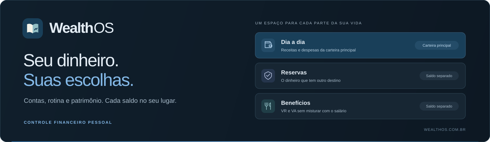
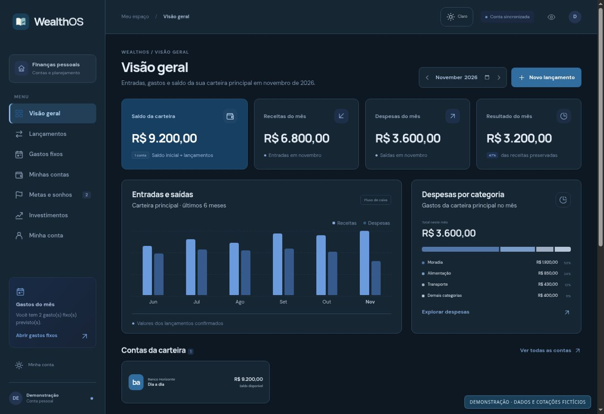
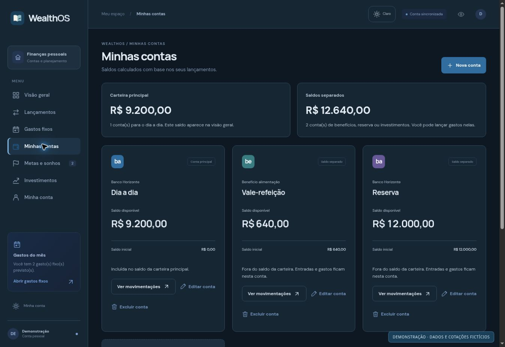
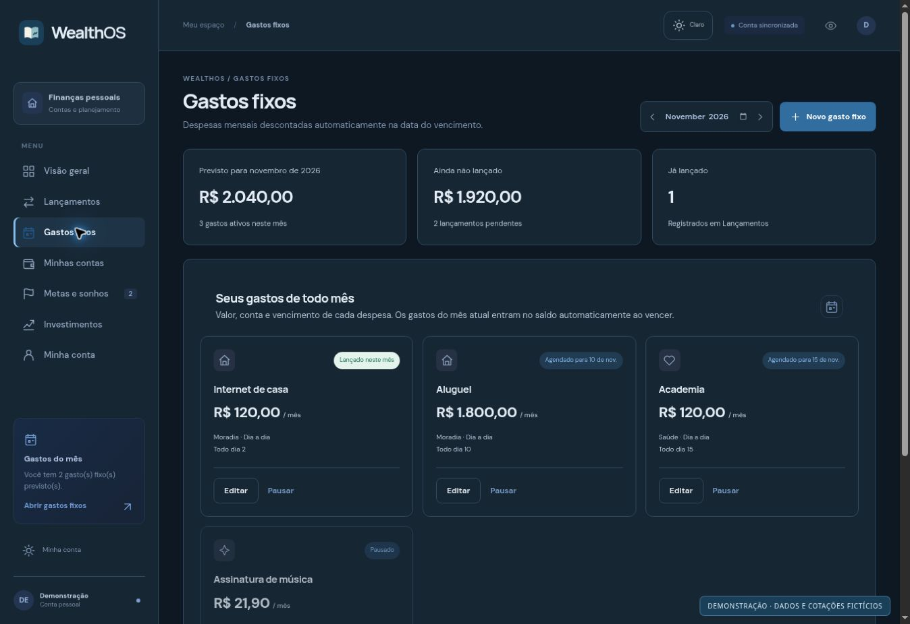
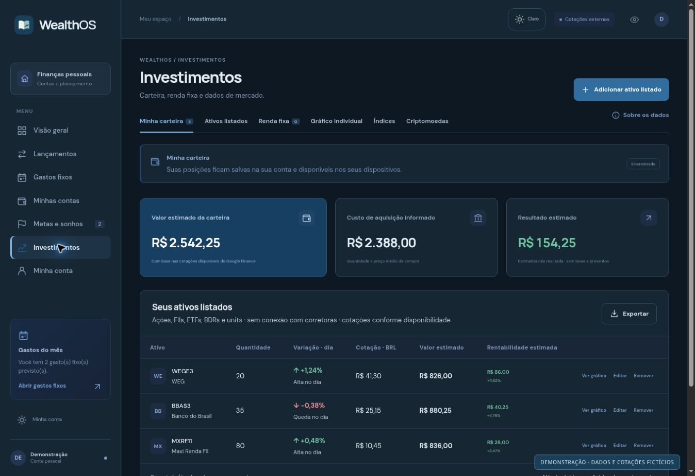

<div align="center">
  <a href="https://wealthos.com.br"></a>

  <p><strong>Organize o presente. Acompanhe o que você está construindo.</strong></p>
  <p>Receitas, despesas, gastos fixos, metas e investimentos.<br />Uma aplicação de finanças pessoais com espaço para cada parte do seu dinheiro.</p>

  <p>
    <a href="https://wealthos.com.br"></a>
    <a href="https://wealthos.com.br/login"></a>
  </p>
  <p>
    
    
    
    
    
    
  </p>
  <p><a href="#por-dentro-do-wealthos">Conheça as telas</a> · <a href="#recursos">Recursos</a> · <a href="#executar-localmente">Executar localmente</a> · <a href="docs/DEVELOPMENT.md">Documentação técnica</a></p>
  <sub>Desktop e celular · Temas claro e escuro · Português, English e Español</sub>
</div>

<br />

## Por dentro do WealthOS

### Uma visão do seu mês, sem perder os detalhes

O painel reúne o saldo da carteira principal, as receitas, as despesas e o resultado do mês. O fluxo dos últimos seis meses e a distribuição por categoria ajudam a entender de onde os números vieram.

<a href="docs/images/overview.jpg"></a>

> As capturas mostram a interface real em um ambiente isolado. Contas, valores, posições e cotações são fictícios, preparados exclusivamente para esta documentação. Novas contas no produto começam sem esses registros.

### O saldo do dia a dia não é o saldo de tudo

Uma reserva ou um vale-refeição pode ficar fora da carteira principal e continuar disponível para registrar movimentações. Você decide quais contas compõem a visão geral e acompanha o histórico de cada uma.

| Carteira principal | Saldos separados |
| --- | --- |
| Contas usadas na rotina. Entradas e gastos aparecem no resumo principal. | VR, VA, reservas ou dinheiro para investir. Movimentações ficam na conta escolhida. |

<details>
<summary><strong>Ver a tela de contas e seus grupos</strong></summary>

<br />
<a href="docs/images/accounts.jpg"></a>

Cada conta tem saldo, movimentações, edição da classificação e exclusão com confirmação. A separação organiza os registros; não abre contas bancárias nem movimenta dinheiro no banco.

</details>

### As contas que voltam todo mês também têm seu lugar

Configure descrição, valor, categoria, conta e vencimento. Os gastos vencidos do mês atual entram no saldo da conta vinculada ao abrir ou atualizar os dados. Com o app aberto, a verificação também ocorre a cada minuto, pelo horário de Brasília.

<details>
<summary><strong>Ver gastos lançados, agendados e pausados</strong></summary>

<br />
<a href="docs/images/recurring.jpg"></a>

Cada regra gera no máximo um lançamento por mês. Pausar preserva o histórico; estornar um lançamento não provoca outro desconto automático naquele mês. Meses anteriores podem ser conferidos e registrados manualmente.

</details>

### Sua carteira, além do saldo da conta

Registre posições, consulte a variação do dia e acompanhe o valor e o resultado estimados quando houver dados suficientes. A área de investimentos segue a ordem:

**Minha carteira → Ativos listados → Renda fixa → Gráfico individual → Índices → Criptomoedas.**

<details>
<summary><strong>Ver a carteira de investimentos</strong></summary>

<br />
<a href="docs/images/investments.jpg"></a>

Ações, FIIs, ETFs, BDRs e units contam com busca assistida. A renda fixa tem registros próprios para modalidades como Tesouro Direto, CDB, LCI e LCA. A aplicação acompanha registros e cotações; não executa ordens nem conecta corretoras.

</details>

## Recursos

| No seu dia a dia | Na hora de conferir |
| --- | --- |
| **Lançamentos:** entradas e gastos por conta, data e categoria. | **Filtros e busca:** encontre movimentações por descrição, tipo, categoria e conta. |
| **Gastos fixos:** regras mensais, vencimentos, pausa e registro sem duplicidade por regra/mês. | **PDFs:** relatório do período filtrado ou de todo o histórico, com entradas, gastos e categorias. |
| **Contas:** carteira principal, benefícios e reservas separados. | **Extratos PDF:** leitura no navegador, prévia e revisão antes de confirmar a importação. |
| **Metas e sonhos:** valor desejado e progresso registrado. | **Investimentos:** posições, renda fixa e estimativas conforme dados disponíveis. |
| **Valores com centavos:** máscara monetária, como `232323` → `2.323,23` em português. | **Privacidade na tela:** oculte os valores durante o uso. |
| **Google ou e-mail:** acesso autenticado e registros vinculados ao usuário. | **Temas e idiomas:** claro/escuro, detecção do idioma do navegador e escolha manual. |

### Do navegador para a tela inicial

O WealthOS pode ser instalado como **PWA**, pela opção em **Minha conta**, em navegadores compatíveis. A interface acompanha celular e desktop; seus registros ficam associados à conta. É necessária conexão para acessar e salvar os dados financeiros.

**Idiomas da aplicação:** português, inglês e espanhol. **Moeda dos registros:** real brasileiro, BRL.

## Como começar

1. **Entre ou crie sua conta** com Google ou e-mail.
2. **Cadastre a conta principal** e informe o saldo inicial. Adicione benefícios e reservas como saldos separados, se precisar.
3. **Registre uma entrada e um gasto**, ou revise um extrato PDF compatível antes de importar.
4. **Configure suas recorrências** e confira o resultado na visão geral.

<div align="center">
  <a href="https://wealthos.com.br/login"><strong>Abrir meu espaço financeiro →</strong></a>
</div>

## Como o projeto funciona

| Parte | Tecnologia e responsabilidade |
| --- | --- |
| **Aplicação** | Angular 20 + TypeScript: painel, formulários, gráficos e experiência financeira. |
| **Páginas públicas e APIs** | Next.js 16 + React 19: landing page, guias, autenticação e rotas do servidor. |
| **Dados e identidade** | Supabase Auth + PostgreSQL, com políticas RLS por usuário. |
| **Regras financeiras** | `@wealthos/finance`: cálculos compartilhados, valores em centavos e validações. |
| **Qualidade** | Node.js Test Runner + `tsx`; testes de banco e RLS com PGlite. |
| **Publicação** | Vercel, integrada ao repositório GitHub. |

O build compila a interface Angular para `public/app` e depois gera o Next.js. O servidor atende as páginas públicas, as APIs e o acesso protegido ao painel. O NestJS/Prisma preservado em `wealthos-source/apps/api` é histórico e não é o backend da aplicação atual.

## Executar localmente

Requer **Node.js 24**, npm e um projeto Supabase de desenvolvimento configurado.

```bash
git clone https://github.com/matheusaaguirra/WealthOS.git
cd WealthOS
npm ci
npm ci --prefix wealthos-source --ignore-scripts
cp .env.example .env.local
```

Preencha `.env.local` com `SUPABASE_URL`, `SUPABASE_PUBLISHABLE_KEY` e `APP_URL=http://localhost:3000`. `BRAPI_TOKEN` é opcional. Configure o esquema e as URLs de retorno do Auth conforme o [guia de desenvolvimento](docs/DEVELOPMENT.md).

```bash
npm run build:web
npm run dev
```

Abra [localhost:3000](http://localhost:3000). Alterou o Angular? Execute `npm run build:web` novamente para atualizar a interface servida.

| Comando | Uso |
| --- | --- |
| `npm run build` | Build completo de Angular e Next.js. |
| `npm test` | Suíte de testes da raiz e compilação prévia do núcleo financeiro. |
| `npm run typecheck` | Verificação de tipos do Next.js. |
| `npm start` | Servidor após o build de produção. |

<details>
<summary><strong>Estrutura do repositório</strong></summary>

| Caminho | Conteúdo |
| --- | --- |
| [`app`](app) | Páginas, APIs e callbacks de autenticação. |
| [`components`](components) | Landing page, guias e componentes públicos. |
| [`lib`](lib) | Validação, persistência, mercado e conteúdo editorial. |
| [`wealthos-source/apps/web/src`](wealthos-source/apps/web/src) | Interface Angular, estilos e traduções. |
| [`wealthos-source/packages/finance`](wealthos-source/packages/finance) | Núcleo de regras financeiras. |
| [`supabase/migrations`](supabase/migrations) | Esquema, políticas RLS e controle de concorrência. |
| [`test`](test) | Testes e cenários de regressão. |
| [`docs`](docs) | Documentação técnica e imagens desta apresentação. |

</details>

## Dados, segurança e limites

Os registros são vinculados ao usuário autenticado, com RLS no PostgreSQL, validação no servidor e controle de versão para rejeitar gravações desatualizadas. A aplicação usa a chave publicável e a sessão do usuário, sem exigir `service_role`. Credenciais nunca devem entrar no repositório.

<details>
<summary><strong>O que considerar antes de usar</strong></summary>

- **Bancos:** não há sincronização por Open Finance, pagamentos ou execução de compras e vendas.
- **PDFs:** importação de arquivos com texto selecionável, até 10 MB e 20 páginas. Não há OCR embutido nem compatibilidade garantida com todos os bancos. Confira a prévia.
- **Gastos fixos:** o registro automático cobre os vencidos do mês atual ao acessar ou atualizar o app; não é um agendamento bancário ou uma rotina executada com o app fechado.
- **Mercado:** cotações podem ter atraso ou ficar indisponíveis. Sem custo ou cotação suficiente, a rentabilidade não é calculada. As estimativas não incluem todos os custos, impostos ou proventos.
- **PWA:** instalação depende do navegador e do sistema. Não há edição financeira offline.
- **Feedback:** o formulário atual prepara um e-mail no aplicativo do visitante. O envio direto pelo servidor depende da ativação da integração de e-mail.

</details>

## Para conhecer melhor

| Produto e uso | Desenvolvimento |
| --- | --- |
| [Organizar gastos fixos](https://wealthos.com.br/guias/como-organizar-gastos-fixos) | [Ambiente, arquitetura e comandos](docs/DEVELOPMENT.md) |
| [Importar um extrato PDF](https://wealthos.com.br/guias/como-importar-extrato-bancario-pdf) | [Autenticação e sessões](docs/AUTH.md) |
| [Controle mensal](https://wealthos.com.br/guias/como-controlar-gastos-mensais) | [Configuração do Google OAuth](docs/GOOGLE-OAUTH-SETUP.md) |
| [Separar conta, reserva e VR](https://wealthos.com.br/guias/separar-conta-reserva-vale-refeicao) | [Dados de mercado](docs/MARKET-SOURCES.md) · [Google Finance](docs/GOOGLE-FINANCE.md) |

Os guias públicos também têm conteúdos em [English](https://wealthos.com.br/en/guides), [Español](https://wealthos.com.br/es/guias), [Français](https://wealthos.com.br/fr/guides), [Deutsch](https://wealthos.com.br/de/ratgeber) e [Italiano](https://wealthos.com.br/it/guide). O simulador editorial aceita exemplos em BRL, USD e EUR; isso não altera a moeda nem os três idiomas disponíveis no app.

---

<div align="center">
  
  <p><strong>Seu dinheiro. Seu ritmo. Sua direção.</strong></p>
  <p><a href="https://wealthos.com.br">wealthos.com.br</a> · Desenvolvido por <a href="https://github.com/matheusaaguirra">Matheus Aguirra</a></p>
</div>
