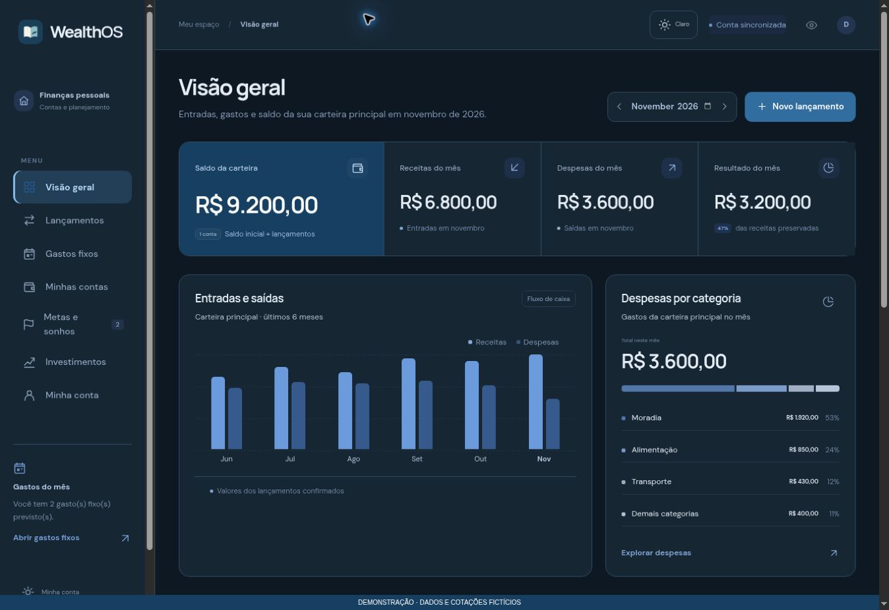

# Revisão visual — novembro de 2026

Direção: organização financeira pessoal, com o saldo do dia a dia como ponto de partida. A identidade existente continua sendo o azul profundo, DM Sans, Manrope e a marca do livro.

## O que mudou

- **Visão geral:** um resumo conectado, com destaque para a carteira principal e menos competição entre os quatro indicadores. No celular, saldo em largura total, entradas e saídas lado a lado e resultado em uma linha própria.
- **Contas:** hierarquia entre instituição, nome e saldo; explicação dos grupos mais legível; movimentações como ação principal e exclusão identificada por cor e texto.
- **Gastos fixos:** retirada da caixa externa em torno dos cartões, valores e vencimentos mais claros, ações com área mínima de toque de 44 px.
- **Investimentos:** cabeçalhos com quebras naturais, números alinhados, ações distinguíveis e tabela convertida em registros quando falta espaço. Resumos empilhados no celular.
- **Navegação e formulários:** menu recolhido também no tablet, escala de cantos e botões consistente e foco visível.
- **Landing:** apresentação mais direta do produto em português, inglês e espanhol, demonstração legível, botões arredondados e menos decoração. Textos ficam visíveis durante a rolagem; a entrada inicial, o gráfico e as respostas às ações concentram o movimento.

## Referência aplicada

[taste-skill](https://github.com/Leonxlnx/taste-skill), versão 2.5.1: hierarquia, alinhamento, produto visível, texto objetivo, superfícies discretas, microinterações e movimento reduzido.

A aplicação existente continua em Next.js e Angular. Preservamos as rotas reais de login e feedback, as cores aprovadas e os avisos de dados ilustrativos. Não substituímos serviços ativos por exemplos nem convertemos o backend em exportação estática.

## Validação

- Build Angular e build Next.js de produção.
- TypeScript sem erros e 128 testes automatizados aprovados.
- Inspeção em navegador real: visão geral em 320, 390, 768, 1024 e 1440 px; contas, gastos fixos, carteira e formulário em tamanhos representativos de celular e desktop/tablet.
- Conferência dos temas claro e escuro; abertura do menu e seletor de categorias; fechamento do formulário sem gravação; controles de período e grupos da demonstração da landing.
- Dados financeiros e cotações usados na revisão são fictícios, com requisições interceptadas somente em uma página local temporária. Essa página não faz parte do deploy.
- O lint de texto da referência não encontrou FAIL. Seu aviso sobre a sequência 45/35/20 foi mantido: são percentuais da demonstração da carteira, explicitamente identificada como ilustrativa, não estatísticas sobre clientes.

O gate automatizado de Chrome da referência não foi executado: a revisão visual utilizou o navegador disponibilizado pelo ambiente. Não há declaração de `GATE: PASS`, auditoria WCAG completa ou teste com dados privados de produção.

